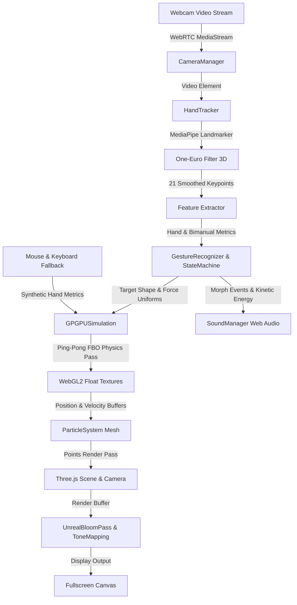

# SPARVYOM System Architecture Overview

This document specifies the end-to-end dataflow, component topology, and execution lifecycle of SPARVYOM.

## High-Level Topology

## Key Modules

### 1. `GPGPUSimulation.ts`
- Allocates two pairs of `WebGLRenderTarget` objects (`posTargetA/B`, `velTargetA/B`) using `FloatType` and `RGBAFormat`.
- Runs offscreen compute passes using an orthographic camera and fullscreen plane mesh.
- Position pass integrates velocity: $\mathbf{x}(t + \Delta t) = \mathbf{x}(t) + \mathbf{v}(t + \Delta t) \Delta t$.
- Velocity pass computes composite forces:
  - Spring-damper steering to active target shape: $\mathbf{F}_{\text{steering}} = -k_s (\mathbf{x} - \mathbf{x}_{\text{target}}) - k_d \mathbf{v}$.
  - Fluid curl noise: $\mathbf{F}_{\text{curl}} = \nabla \times \mathbf{\Psi}$.
  - Hand attractor/repulsor: $\mathbf{F}_{\text{hand}} = S \frac{M}{d^2 + \epsilon} \hat{\mathbf{r}}$.
  - Swirl vortex: $\mathbf{F}_{\text{swirl}} = (\mathbf{v}_{\text{hand}} \times \hat{\mathbf{r}}) \omega$.

### 2. `ParticleSystem.ts`
- Creates a `THREE.Points` object with $N$ vertices.
- Assigns static UV reference coordinates attribute `aReference` to sample from the GPGPU textures inside the vertex shader.
- Utilizes custom vertex shader for distance-attenuated point sizing and dynamic color palette gradients.
- Fragment shader renders soft Gaussian radial falloff with a radiant white-hot core.
- Configured with `blending: THREE.AdditiveBlending` and `depthWrite: false` to avoid sorting overhead while rendering luminous volumetric glow.

### 3. `HandTracker.ts` & `OneEuroFilter.ts`
- Uses Google MediaPipe Hand Landmarker via `@mediapipe/tasks-vision`.
- 21 landmarks per hand are filtered via One-Euro adaptive lowpass filters:
  - Jitter is eliminated at low velocity without introducing perceptible latency during rapid sweeps.
- Extracts palm center, palm normal, velocity vector, pinch distance, and finger extension states.

### 4. `SoundManager.ts`
- Generative audio layer built on the Web Audio API.
- Continuous low-frequency drone oscillator modulated by particle kinetic energy.
- Pentatonic bell chimes sounded during shape morph transitions.
